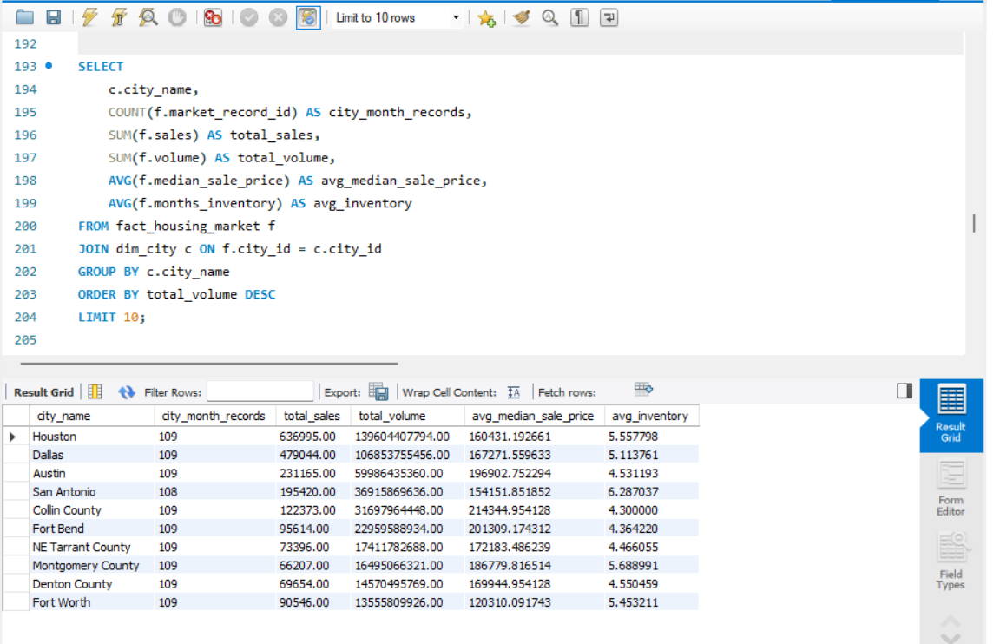

# Housing Market Analysis | SQL

## Overview
I completed this course project using MySQL Workbench to analyse 5,000 housing market records. I explored sales, transaction values, prices and inventory across cities, years and market segments.

Each record represents one city's housing market activity for a particular month.

## SQL Results Preview
Top 10 cities by total transaction value in the supplied dataset.

## What I Did
- Checked table row counts, date ranges and record uniqueness.
- Identified missing values in sales, transaction values, prices, listings and inventory.
- Joined fact and dimension tables to compare cities and years.
- Used filtering, GROUP BY, HAVING and aggregate functions to calculate KPIs.
- Investigated duplicate records introduced by a one-to-many city-tag join.
- Produced a stakeholder summary table and an insight report.

## SQL Skills
MySQL, INNER JOIN, LEFT JOIN, CASE WHEN, GROUP BY, HAVING, COUNT DISTINCT, SUM, AVG, filtering and sorting.
Common Table Expressions (CTEs) and RANK() OVER with PARTITION BY.

## Selected Findings
The findings below are documented in my project report:
- Houston recorded the highest total sales and transaction value.
- 2014 had the highest transaction value, while 2006 had slightly more sales.
- Large markets had the highest total sales, transaction value and average median sale price.
- Missing values were most common in listings and months of inventory.

## Data Quality and Limitations
- Results describe the supplied course dataset.
- Partial 2015 coverage limits comparisons with complete years.
- AVG(median_sale_price) is an average of city-month medians, not an overall median property price.
- COUNT(DISTINCT) prevents duplicate record counts after the tag join; it does not correct inflated financial sums.
- Financial totals were calculated without joining the tag bridge.

## Project Files
- [SQL analysis](Namitha_KannothVeedu_Housing_SQL_Project.sql)
- [Insight report](Namitha_KannothVeedu_Housing_Insight_Report.md)
- [Additional SQL queries using CTEs and ranking](OptionalStretch.sql)

## Viewing the Work
Open the SQL file to review the queries and the insight report to read the findings.

Running the queries requires MySQL and the populated housing_assignment database. Database setup and source data are not currently included in this repository.
The additional queries require MySQL 8.0 or later.

## Author
Namitha Kannoth Veedu
